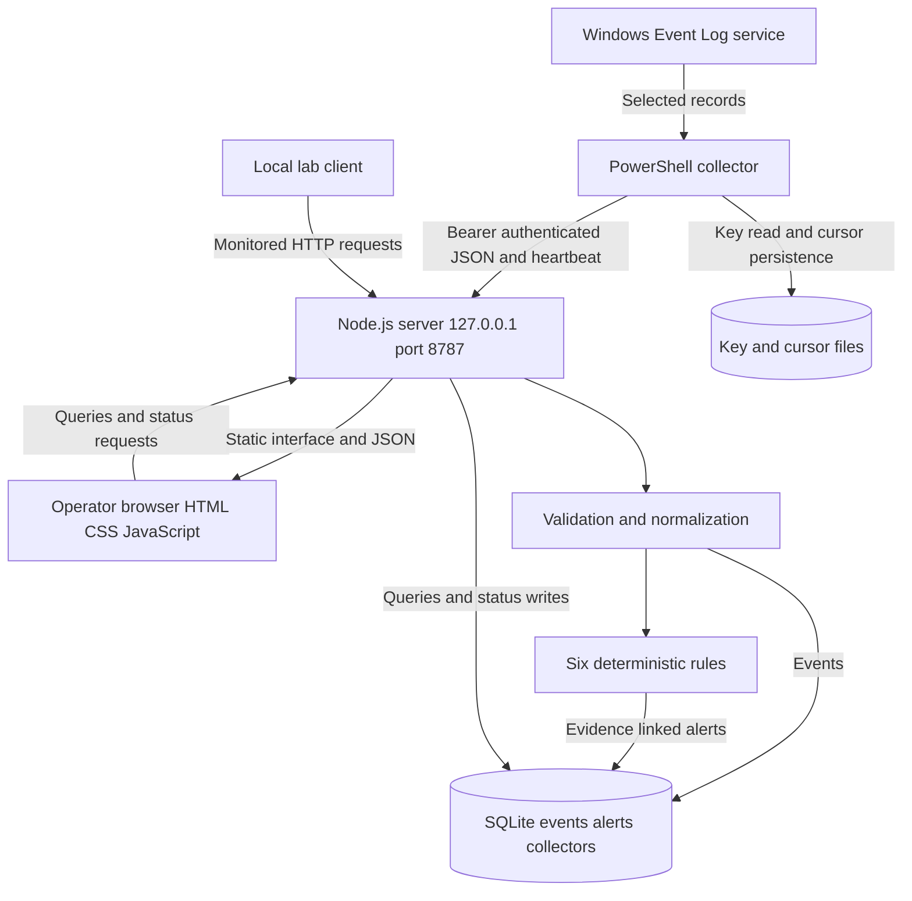
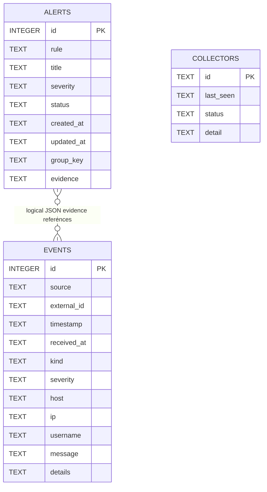
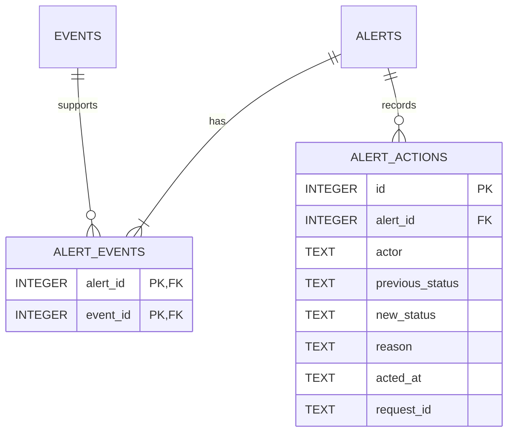
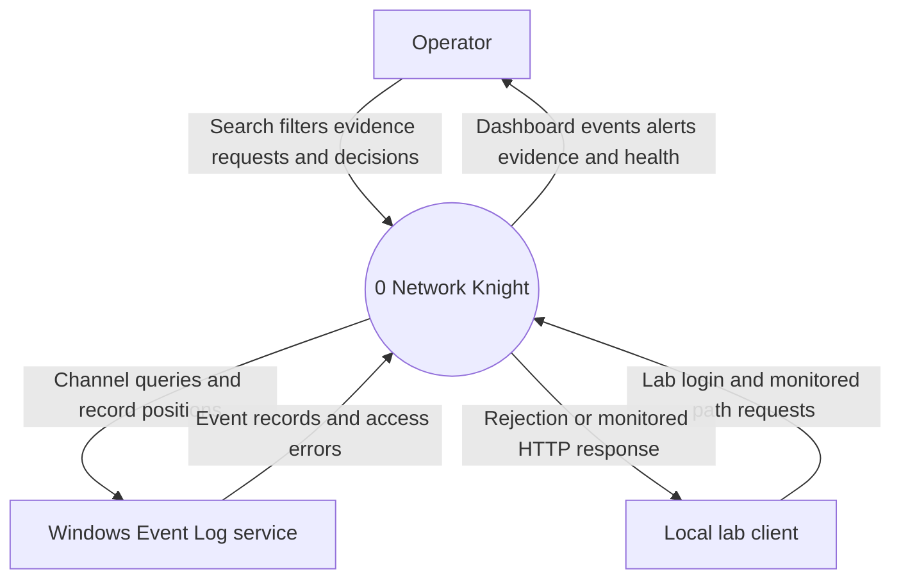
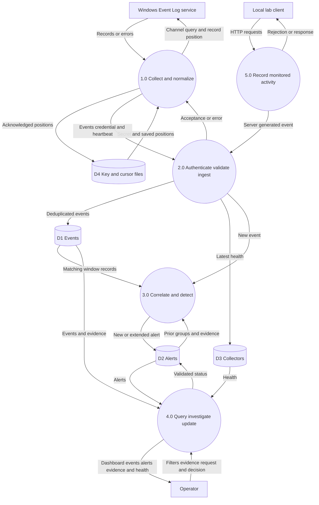
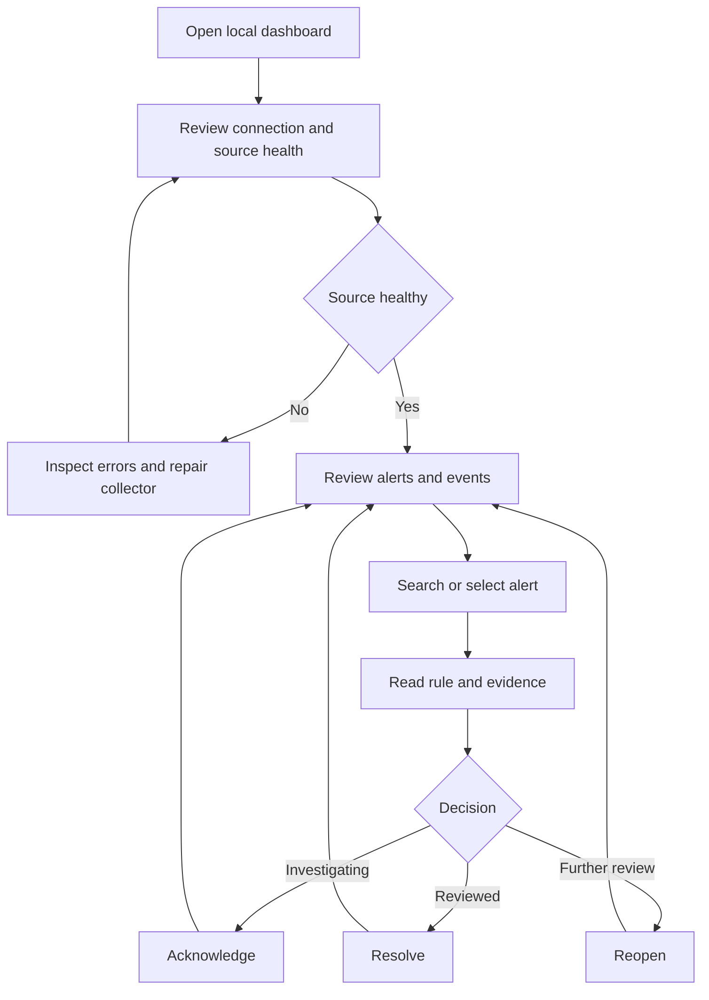
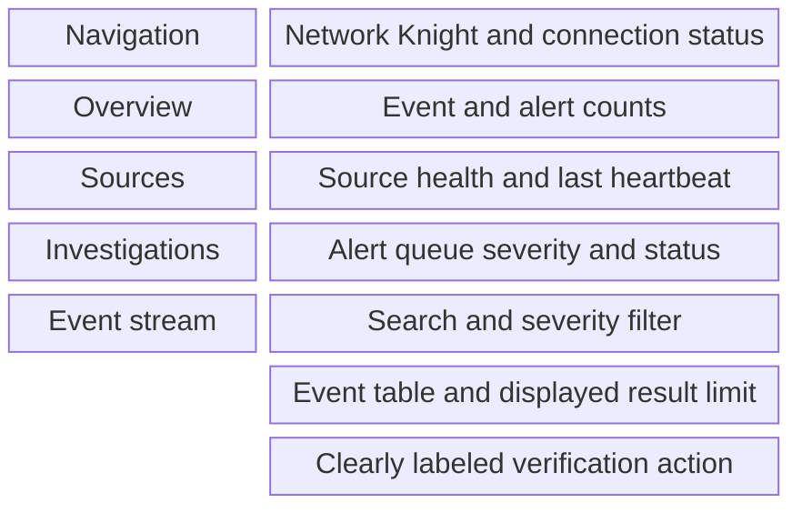
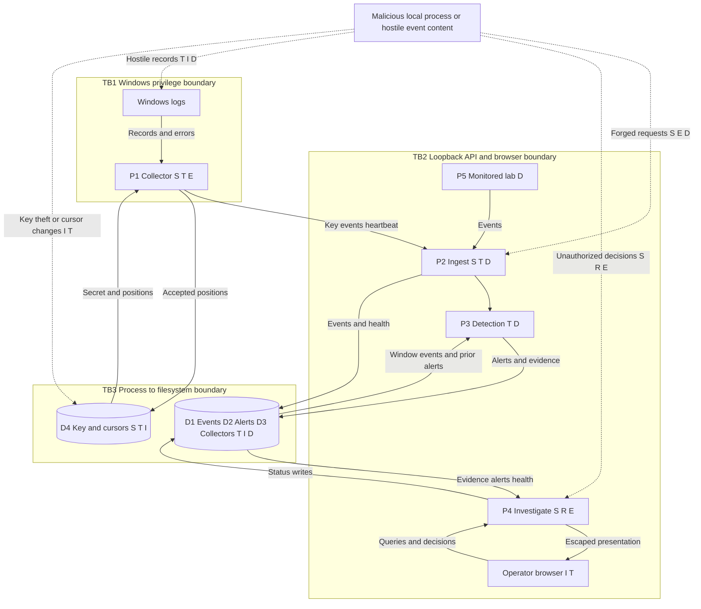

# Network Knight System Design

**Senior Design Design Phase | Arif Shahriar Anik | October 28 2026**

## 1 Purpose and scope

Network Knight monitors selected security events on a Windows workstation. It collects Windows Event Logs and requests to its own monitored HTTP endpoints, normalizes and stores records, evaluates six explainable rules, and presents alerts with supporting evidence. An operator investigates alerts and acknowledges, resolves, or reopens them.

The architecture combines a browser client, modular monolithic Node.js backend, separate PowerShell collector, and SQLite database. Presentation, application logic, and persistence are three logical tiers deployed on one workstation. This supports an inexpensive academic prototype without a cloud dependency.

**Status convention:** Existing means present in the inspected code. Planned means a proposed implementation or operational improvement. Benchmark targets are acceptance criteria, not measured results. No framework certification or full compliance is claimed.

The supported deployment assumes one trusted Windows operator and an uncompromised host. The tool does not capture arbitrary network traffic, monitor every application, use AI, or automatically block threats. Its rejecting lab login endpoint demonstrates detection and is not dashboard authentication.

| Requirement | Design response | Acceptance evidence |
|---|---|---|
| Collect real activity | Windows polling and monitored HTTP requests | Authorized Windows and HTTP end to end checks |
| Preserve evidence | SQLite WAL and atomic batch writes | Restart preserves committed evidence and statuses |
| Explain detections | Fixed rules and linked event IDs | Trace each alert to triggering events |
| Support investigation | Search, severity filter, evidence dialog and status actions | Completed investigation walkthrough |
| Report visibility gaps | Heartbeat, channel errors and offline indication | Collector outage test |
| Protect telemetry | Local binding; stronger ACLs, retention and audit history planned | Access and configuration checks |

## 2 System architecture

### High level architecture

Validation and detection are logical modules inside the backend rather than separate services. All HTTP traffic remains on loopback.

| Component | Responsibility | Access boundary |
|---|---|---|
| Browser | Presentation, filters, evidence and investigation actions | Untrusted log content must be escaped |
| HTTP server | Static assets, routes and API controls | Local binding; dashboard currently trusts OS user |
| Ingestion logic | Authenticate collector, validate batch, normalize, deduplicate and commit | Bearer key for ingestion and heartbeat |
| Rule engine | Correlation, alert creation and evidence updates | Server side business logic |
| SQLite | Persistent events, alerts and collector health | Local file; no database listener |
| PowerShell collector | Channel queries, XML parsing, upload and heartbeat | Security channel may need elevated rights |
| Runtime files | Secret key and acknowledged record positions | Windows ACL protection required |

### Decisions and tradeoffs

1. **Modular monolith:** Easy to launch, inspect and debug within a senior design schedule. One process is a shared failure domain. Planned refactoring separates routing, validation, rules and repositories without adding distributed deployment.
2. **SQLite:** Transactions and parameters provide reliable local persistence without a database server. Synchronous database work can block the Node.js event loop; WAL does not eliminate that limitation.
3. **PowerShell polling:** Native Windows integration avoids another agent dependency. Polling introduces latency and can miss overwritten logs during outages.
4. **Deterministic rules:** Reproducible and explainable without training data. Coverage is narrow; a rule match requires investigation.
5. **Local boundary:** Loopback reduces remote exposure but does not authenticate local processes or protect against malware executing as the operator.
6. **Two second browser refresh:** Simple for one operator. Streaming and queues are deferred until measurements justify operational complexity.

### Authentication and authorization

**Existing:** Ingestion and heartbeat require a randomly generated 32 byte secret encoded as hex, compared using a length check and timing safe comparison. Dashboard reads have no user login. Alert updates require `X-Network-Knight: dashboard` and global Host/Origin restrictions. That header helps resist browser cross origin mutation; it is not a user credential and can be sent by local programs.

**Planned local controls:** Explicit Windows ACLs for runtime files, an unelevated Node.js process, collector elevation only where necessary, and documented secret rotation. Code executing as the trusted operator remains a residual risk.

**Conditional shared or remote extension:** Before changing binding, add established identity provider authentication, server enforced viewer/analyst roles, administrator controls, privileged MFA, HTTPS, secure HttpOnly session cookies, CSRF protection, expiration and revocation. Collector credentials must never authorize operator actions. These are not existing components.

## 3 Database and data model

### Existing schema

Timestamps are UTC ISO 8601 text. Application code supplies most constraints; existing tables lack foreign keys and severity/status CHECK constraints.

| Table | Fields and types | Keys and constraints |
|---|---|---|
| events | id INTEGER; source TEXT; external_id TEXT nullable; timestamp TEXT; received_at TEXT; kind TEXT; severity TEXT; host TEXT; ip TEXT; username TEXT; message TEXT; details TEXT | id primary key; all remaining fields NOT NULL except external_id; details holds JSON text |
| alerts | id INTEGER; rule TEXT; title TEXT; severity TEXT; status TEXT default open; created_at TEXT; updated_at TEXT; group_key TEXT; evidence TEXT | id primary key; all remaining fields NOT NULL; evidence holds a JSON array of event IDs |
| collectors | id TEXT; last_seen TEXT; status TEXT; detail TEXT | id primary key; remaining fields NOT NULL; latest heartbeat replaces prior state |

Existing indexes are partial unique `events(source,host,external_id)` when external_id is not null; correlation `events(kind,source,host,ip,username,timestamp)`; and `alerts(rule,group_key,created_at)`. Rules live in code. Events have no collector foreign key.

An alert has at least one event when created; an event can support several alerts. The logical many to many relationship is not database enforced. Collectors are unconnected because the physical schema has no event relationship.

### Planned evidence and action history

Enable `PRAGMA foreign_keys=ON` per connection; restrict deletion of linked evidence; add status, severity and JSON validity constraints. Commit each transition and audit row together. Local actor information records the OS operator context; distinguishing people requires authenticated sessions.

Migration: consistent backup; create tables; validate every evidence array and reference; backfill unique pairs; compare counts; switch readers/writers; retain old column through rollback validation. Missing references need review. No migration is executed by this report.

### Data lifecycle

Validate complete batches before a transaction; insert events and derived alerts atomically. Stable Windows identity combines record ID and timestamp, with source and host in the unique index. Retries do not double count; a stolen key can still fabricate new identities.

Store event time and receipt time. Missing event time currently defaults to now; planned metadata should flag inferred times. Lab passwords are omitted, but Windows messages can expose accounts and paths. Minimize fields and sanitize exports.

Plan at least 90 days retention if adopting CIS safeguard 8.10, with unresolved evidence pinned and capacity/privacy approval. Current storage has no retention automation. Plan daily protected consistent backups and restore tests. Copying only a live SQLite file with active WAL is unsafe; use consistent backup support or stop the server cleanly before copying complete database state.

## 4 Technology stack and justification

| Technology | Reason selected | Constraint |
|---|---|---|
| JavaScript | Shared server/browser language and inspectable rules | Explicit type and input validation needed |
| Node.js | Built in HTTP, crypto, filesystem and SQLite; no required npm install | Pin a supported compatible release; repository minimum 22.13, README prefers Node 24 LTS |
| node:http | Small allowlisted API and simple deployment | Team owns limits, routing and errors |
| SQLite and node:sqlite | Local transactions, parameters and low cost [5] | Synchronous work blocks event loop; limited write concurrency |
| HTML5 and CSS | Lightweight responsive interface and semantic controls | Direct accessibility testing required |
| Browser Fetch | Simple JSON queries and refresh | Polling cost and stale state handling |
| PowerShell and Get-WinEvent | Native Windows queries and XML extraction [6] | Windows only; channel permissions and audit policy |
| Loopback HTTP and JSON | Inspectable local interchange without cloud certificates | Unencrypted; trusted local boundary only |
| Node test runner and PowerShell fixtures | Rule, API, persistence and parser testing with few dependencies | Fixtures do not prove live collection |
| Git with excluded runtime data | Reviewable source without logs and keys | Ignore rules cannot remove secrets already committed |

These choices fit the existing code without a React, FastAPI or cloud rewrite. Team proficiency is not measured; shared JavaScript reduces onboarding, while Windows administration and backend security testing still require assigned owners. Hosting and commercial subscriptions are not required; hardware, maintenance and protected backups still have costs.

## 5 Level 0 context diagram

The boundary contains the delivered browser UI, backend, collector, rules, database and runtime files. The human operator, Windows Event Log service and lab client are external entities. Windows is external as a source even on the same workstation. Internal stores are not context entities.

No external identity provider, notification service or cloud database exists in the current context. Remote access would change it.

## 6 Level 1 data flow diagram

Processes transform information; D1 to D4 are stores. D1, D2 and D3 are logical stores in one SQLite file. P2 invokes P3 within the ingest transaction.

External inputs and outputs balance the context diagram. The local HTTP path enters P2 as a server generated event; it is not an unauthenticated collector upload.

### Ingestion and failure handling

1. Poll three channels every five seconds, at most 200 matching records per channel in oldest first order. First run starts at the current end; historical records are not automatically imported.
2. Parse XML into source, kind, host, account, available IP, UTC time and provider context. Missing values remain unknown.
3. Submit JSON with bearer credential. Validate Host and Origin where present, route, key, required fields, timestamp, batch and body limits. Each API batch has 1 to 500 events and at most 1 MiB.
4. Normalize and sort within the batch; begin transaction; deduplicate; insert new events and evaluate rules; commit.
5. Return accepted/duplicate counts. Advance a channel cursor only after acceptance. A lost reply followed by retry does not double count committed stable identities.
6. Persist cursors using temporary file replacement. Send heartbeat; unreadable channels are degraded. UI declares offline after 30 seconds without a fresh heartbeat.

Heartbeat proves recent communication, not complete collection. Audit configuration, overwritten records, outage duration and clock errors remain visibility risks.

### Detection design

| Rule | Condition and grouping | Severity and interpretation |
|---|---|---|
| AUTH-001 | Five auth_failure records in inclusive 60 seconds; source, host, IP, username | High; review repeated failures |
| WEB-001 | Five web_probe records in 60 seconds; source, host, IP | Medium; only this app's sensitive monitored paths |
| WIN-001 | Security 1102 audit_cleared | Critical; possible evidence removal |
| WIN-002 | Security 4720 account_created | Medium; verify authorization |
| WIN-003 | Security 4697 or System 7045 service_installed | Medium; verify service provenance |
| WIN-004 | Defender Operational 1116 malware_detected | High; inspect threat and remediation context |

Security 4624, System 6005/6006 and Defender 1117 provide context. Repeated threshold matches within approximately one minute of alert creation extend evidence rather than generate repeated alerts. A resolved alert remains resolved within that suppression period even if evidence grows. Planned UI work must explain this and establish whether fresh evidence should reopen an investigation.

Sorting is within each batch. Very late events across batches are not fully re-correlated. Plan a bounded lateness policy and cross batch tests. An empty alert queue is not evidence that a host is safe.

### API contracts

| Method and path | Input or purpose | Response and access |
|---|---|---|
| GET /api/health | Liveness | Name, storage and uptime; local |
| POST /api/ingest | events array | Accepted/duplicate counts; bearer key |
| POST /api/heartbeat | id, status, detail | Latest health update; bearer key |
| GET /api/state | q and severity | Counts, newest 150 matching events, newest 100 alerts, rules, health |
| GET /api/alerts/:id | Numeric ID | Alert and available evidence; 404 if absent |
| PATCH /api/alerts/:id | open, acknowledged or resolved | Update; dashboard header and origin restrictions |
| POST /monitored/login | Lab username | Always 401; password is not stored |

Plan request IDs, stable error codes, generic client errors, diagnostic logs, cursor pagination, rate limits and status reasons. Current search filters events, not the alert list; explain this scope. The 15 second request timeout does not guarantee database query cancellation.

## 7 User interface and experience

### User flow

### Dashboard wireframe

| Area | Content and behavior |
|---|---|
| Header | Connection, last successful update and stale warning |
| Summary | Stored events, active alerts, unresolved critical alerts and rule count |
| Sources | Collector identity, healthy/degraded/offline text, last heartbeat and channel errors |
| Queue | Rule title/ID, severity, status, evidence count and creation time |
| Stream | Account/host/IP/kind/message search, severity selection, matching count and display limit |
| Rows | Time, severity text, kind/message, source/host, account/IP |
| Lab | Explain five rejected requests; disable during run and show resulting alert |

The evidence dialog displays title, rule, severity, state and each event's time, message, host, source, account, IP and escaped details. Existing actions are Acknowledge, Resolve, Reopen and Close. Add a complete trigger explanation and grouping context. Planned controls collect a reason and display actor/time/history. Use a version or updated time condition to reject stale concurrent changes. Failed updates must not imply success.

Require keyboard access, visible focus, labels, modal focus containment/restoration, contrast and severity words alongside color. Refresh must preserve typed text and focus. Retain stale results with a warning on failure. Stack panels on narrow screens and scroll wide tables horizontally. Existing labels and status roles cover part of this; full browser and screen reader behavior requires verification.

## 8 Standards frameworks and constraints

NIST CSF organizes risk outcomes, OWASP ASVS supplies application verification requirements, and CIS Controls guides operational safeguards. These are scoped mappings rather than compliance claims.

### NIST Cybersecurity Framework 2.0

**URL:** https://www.nist.gov/cyberframework

**Summary:** A framework of cybersecurity outcomes organized into Govern, Identify, Protect, Detect, Respond and Recover. It is outcome oriented and does not prescribe one implementation [1].

**Relationship:** Monitoring and investigation directly support Detect and Respond. The application's own evidence also needs governance, protection and recovery.

| Function | Application | Evidence or remaining work |
|---|---|---|
| Govern | Assign collection, retention, risk and deployment owners | Planned risk register and local use policy |
| Identify | Inventory host, channels, rules, data and dependencies | Architecture, source list and known gaps |
| Protect | Authenticate ingestion, validate inputs, restrict files and minimize data | Key checks exist; ACL and rotation verification planned |
| Detect | Six rules and freshness reporting | Threshold/grouping tests and source outage test |
| Respond | Evidence review and status workflow | Existing states; audit history and escalation runbook planned |
| Recover | Consistent backups and restore exercise | Planned measured recovery demonstration |

Organization wide governance, institutional incident authority and enterprise recovery are outside this application's scope. Those outcomes require external processes and owners.

### OWASP Application Security Verification Standard 5.0

**URL:** https://asvs.owasp.org/

**Summary:** Requirements for secure design and verification of web applications and services; the official site identifies 5.0.0 as its stable release [2].

**Relationship:** Network Knight accepts untrusted records, renders messages and changes investigation state through HTTP APIs.

| Relevant area | Application | Verification or exclusions |
|---|---|---|
| Encoding and injection | SQL parameters, escaped output and static asset allowlist | Test hostile messages, markup and SQL characters |
| Validation and business logic | Atomic batch validation, body/time limits and status allowlist | Plan strict field types and valid bounded JSON |
| Authentication and authorization | Collector credential distinct from operator trust | OS boundary now; proper sessions and roles before remote use |
| Browser security | Host/Origin restrictions, mutation header, CSP and frame prevention | Browser testing; header does not authenticate a person |
| Data protection and logging | Omit lab passwords, protect files and audit decisions | ACLs, action history and retention planned |
| Communication/configuration | Loopback and supported runtime | TLS and secure sessions before network exposure |

Maintain a version pinned applicability checklist containing requirement text, rationale, evidence and results. This report maps areas without inventing requirement IDs or asserting a verified ASVS level. Password storage requirements do not apply to current nonexistent operator password accounts; reassess if accounts are added. Remote communication requirements cannot be waived once deployment expands.

### CIS Critical Security Controls v8.1

**URLs:** https://www.cisecurity.org/controls/v8-1 and https://www.cisecurity.org/controls/audit-log-management

**Summary:** Prioritized operational safeguards. Control 8 concerns collecting, alerting, reviewing and retaining audit logs [3].

**Relationship:** Collection and evidence preservation are central to Network Knight, but it cannot prove all host auditing is enabled.

| Safeguard or control | Application | Status and limitation |
|---|---|---|
| 8.1 Log management process | Define channels, review owner, retention and failure handling | Process approval planned |
| 8.2 Collect audit logs | Windows channels and monitored endpoints | Existing; verify policy and permissions separately |
| 8.3 Adequate storage | Measure volume and warn on disk pressure | Capacity measurement and warnings planned |
| 8.4 Time synchronization | UTC event/receipt times and host clock review | UTC exists; skew reporting planned |
| 8.9 Centralize logs | Query selected channels in one store | Partial single host scope; no enterprise aggregation |
| 8.10 Retain logs | At least 90 days if adopting safeguard; pin unresolved evidence | No current automatic retention |
| 8.11 Review logs | Weekly or more frequent documented review | Human process; dashboard access alone insufficient |
| Controls 3 and 6 | Protect log data and restrict access | Collector key exists; ACL and deployment review planned |

Safeguards have implementation group applicability; selecting some does not establish full group conformance. Enterprise network and multi asset coverage are outside current scope. A shorter approved privacy/capacity retention exception must be disclosed and cannot be claimed as 8.10 alignment.

### Constraints

Windows is required for real collection. Rights and audit policy determine visibility; the project must not weaken organizational policy to gain access. Student hardware, disk and one backend constrain capacity. Logs identify users, hosts and paths; obtain host owner authorization and sanitize demonstrations. No FERPA, HIPAA or PCI DSS claim is established without deployment and data classification evidence.

## 9 Threat model diagram

This model reuses DFD processes and stores. P4 includes the browser/server investigation path. Dashed arrows identify attacker activity. S, T, R, I, D and E refer to STRIDE [4]. Boundaries are logical controls, not network subnets.

TB1 separates privileged log access from ordinary execution; TB2 separates supplied data from trusted decisions; TB3 relies on OS file protection. Assets include evidence confidentiality/integrity, alert state, key secrecy, cursor correctness, availability and action history. Adversaries include another local account, operator context malware, hostile webpages and attackers producing malicious log content. A compromised administrator can cross all boundaries; host compromise defeats application only evidence guarantees.

## 10 STRIDE analysis and mitigations

C is confidentiality, I integrity, A availability. Priority is a qualitative engineering judgment, not a measured exploit probability.

| Threat | Components and scenario | Impact and priority | Specific controls and verification |
|---|---|---|---|
| S1 Spoofing | P1/P2/D4: stolen shared key fabricates events or heartbeats under arbitrary collector IDs | I high, A medium; high | Existing random key and timing safe check. Plan ACLs and rotation; individual credentials/source binding if expanded. Test invalid and revoked keys. |
| S2 Spoofing | P4: local code imitates dashboard header and changes alert state | I high, C medium; high | Explicit trusted local operator boundary. Add authenticated sessions/roles for stronger separation. Test that collector credential and header alone cannot authorize extended operator routes. |
| T1 Tampering | P2/P3/D1: manipulated timestamps, identities or fields alter detection grouping | I high; high | Existing limits, future time rejection, parameters, transaction and deduplication. Plan strict types, valid bounded JSON, clock skew and source binding. Test late/manipulated events. |
| T2 Tampering | D1/D2/D4: database or cursor changes erase evidence or skip logs | I high, A medium; high | Plan ACLs, protected backups, relational references and cursor checks. Protect integrity hashes separately if added. Test unauthorized file writes; colocated hashes cannot defeat an administrator. |
| R1 Repudiation | P4/D2: operator denies a status change; current store has no actor history | I high for accountability; high | Plan atomic append only application action rows with actor, old/new state, UTC time, reason and request ID. Protect audit copies separately for stronger assurance. Test exactly one history row per successful change. |
| I1 Information disclosure | Browser/P4/D1/backups: another user, package, screenshot or error reveals account, host and path data | C high; high | Existing loopback, no store responses and data exclusion. Plan ACLs, generic errors, protected backups and sanitized exports. Test another Windows identity. No existing encryption at rest claim. |
| I2 Information disclosure | Browser: log text executes script to read evidence or send actions | C high, I high; high | Existing escaping and CSP. Prefer text nodes where possible; test malicious message, details and username fields. Payload displays as text without execution. |
| D1 Denial of service | P2/P3/D1: repeated requests, nested details, large windows or disk growth block processing | A high, I medium from missed logs; high | Existing 1 MiB/500 event limits, truncation, request timeout and result caps. Plan rate/nesting/evidence bounds, indexes, retention and disk alerts. Measure saturation; row caps do not bound query work. |
| D2 Denial of service | P1/Windows: collector stopped, permissions revoked or channels overwritten | A high, I medium; high | Existing retry, cursor after acceptance, deduplication and heartbeat. Plan gap/backlog diagnostics and outage runbook. Test outages; warnings cannot restore overwritten events. |
| E1 Elevation of privilege | P1/P2: backend flaw inherits admin rights if whole application is elevated | C/I/A high; high | Unelevated backend, minimum collector rights and isolated elevation. Never execute commands from event content. Verify process identities and ACLs. |
| E2 Elevation of privilege | Future P4 roles: viewer or collector reaches analyst/admin API | C high, I high; conditional high | Deny by default route/object authorization, separate credential scopes, server enforced roles and negative role tests. Hidden buttons are insufficient; current prototype has no roles. |

Residual risks include privileged host compromise, operator context malware, incomplete auditing, shared key theft, false positives/negatives, overwritten records and late arrival limitations. Resolve through engineering or explicit scope acceptance.

## 11 Security principles and enforcing controls

| Principle | Enforcing control | Status |
|---|---|---|
| Least privilege | Loopback, unelevated backend, minimal collector rights and ACLs | Binding exists; deployment identity/ACL checks planned |
| Complete mediation | Every request validated; each upload/heartbeat authenticated; allowed statuses | Existing for these routes; operator roles conditional |
| Defense in depth | Input limits, SQL parameters, escaping, CSP, origin checks, OS protection, backup | Several layers exist; OS/recovery additions planned |
| Secure defaults and fail closed | Reject missing keys, invalid batches, foreign hosts/origins and unknown routes | Existing; stricter schema and generic errors planned |
| Minimal attack surface | Small route allowlist, no required npm packages, no DB listener | Existing; runtime patching remains operational work |
| Data minimization | Selected IDs, omit lab passwords, exclude runtime data | Partial existing; field allowlist/export planned |
| Integrity/accountability | Atomic ingest, deduplication, linked evidence and action history | First three exist; relational/action controls planned |
| Separation of duties | Ingestion credential distinct from operator access | Partial; sessions/roles needed for shared use |
| Availability/recovery | Freshness, retries, bounded work, storage warnings, backup | Health/retry exist; resource/recovery additions planned |
| Usable security | Visible gaps, explainable alerts and human review | Existing design; browser verification pending |

## 12 Performance reliability and benchmarks

The nominal collector ceiling is 200 matching records per channel per five second cycle. Across three channels that is about 120 records per second only if work completes within the cycle; queries, sequential uploads and timeouts reduce actual capacity. Uploads are per channel, but large messages can exceed the byte cap.

Dashboard limits bound returned rows, not work. Wildcard searches, counts, evidence arrays and time windows can grow expensive. The current correlation index favors authentication; consider `(kind,source,host,ip,timestamp)` for web grouping after query plan and load analysis. Plan pagination and bounded evidence reads before scaling.

Example capacity scenario: 10 events/second at an assumed 2 KiB per record yields about 1.65 GiB daily, or 148 GiB over 90 days before indexes, WAL and backups. This is neither measured nor expected traffic. Measure size/rate before approving retention. Warn on pressure rather than silently discard required evidence.

| Proposed target | Method | Acceptance criterion |
|---|---|---|
| UI latency | Documented workstation, 100000 stored events, 10 events/second, one operator, 15 minutes | p95 state response below 500 ms; record resources and plans |
| Visibility | Authorized Windows events; healthy no backlog run | p95 event to display within 10 seconds; report clock uncertainty |
| Replay safety | Resubmit accepted identities after lost reply simulation | No extra records or evidence counting |
| Atomicity | Invalid event mixed into valid batch | No partial event/alert commit |
| Rule boundaries | Four/five events, separate identities and outside window records | Exact expected alerts and evidence |
| Outage indication | Stop collector with server/browser active | Offline on first successful refresh after heartbeat age reaches 30 seconds |
| Persistence | Restart after acknowledged writes | Committed evidence and states remain |
| Recovery | Restore latest daily consistent backup in isolation | Proposed RPO at most 24 hours; RTO at most 30 minutes; demonstrate |
| Exhaustion | Authorized bursts and isolated low disk simulation | Controlled errors or warnings, no silent partial commits; record saturation |

Record hardware, runtime, event mix, warmup, duration, p50/p95 latency, failures, accepted rate, backlog and peak storage. Use labeled benign and authorized fixtures for false positives and rule recall. Six successful rule tests do not establish production detection accuracy.

## 13 Implementation and verification plan

| Order | Work | Completion evidence |
|---|---|---|
| 1 Baseline | Pin runtime; verify backend and collector identities and permissions | API/parser tests and authorized Windows collection |
| 2 Integrity | Evidence migration, strict JSON and action history | Copy migration, count/integrity checks, rollback exercise |
| 3 Local security | ACLs, separated privilege, rotation and generic errors | Negative access tests and clean source packages |
| 4 Reliability | Gap/backlog/skew indicators and lateness/suppression policy | Outage, replay, reset and late arrival tests |
| 5 Resources | Limits, storage warnings, retention and backup | Load benchmark, pinned evidence test and restore |
| 6 Usability | Keyboard, focus, labels, errors, search scope and stale state | Browser walkthrough |
| 7 Review | Reconcile requirements, diagrams, threats and frameworks with code | Each implemented control has evidence; exceptions have owners |

The README reports 13 tests passed in an earlier build using an in process transport and records restrictions on live socket, browser and Windows validation. That is historical evidence, not fresh verification in this task. Proposed controls and targets require implementation and demonstration before acceptance.

## 14 References

Official references consulted October 28 2026. Implementation grounding: local README, package.json, server.js, collector/start-collector.ps1, collector/windows-event.ps1, public/index.html and public/app.js. Runtime records and secret values were not needed.

1. NIST. Cybersecurity Framework 2.0. https://www.nist.gov/publications/nist-cybersecurity-framework-csf-20 and https://www.nist.gov/cyberframework/faqs
2. OWASP. Application Security Verification Standard 5.0. https://asvs.owasp.org/ and https://owasp.org/projects/asvs
3. CIS. Controls v8.1 and Audit Log Management. https://www.cisecurity.org/controls/CIS-controls-navigator and https://www.cisecurity.org/controls/audit-log-management
4. Microsoft. Threat Modeling Tool threats and STRIDE. https://learn.microsoft.com/en-us/azure/security/develop/threat-modeling-tool-threats
5. Node.js. SQLite API. https://nodejs.org/api/sqlite.html
6. Microsoft. Get-WinEvent. https://learn.microsoft.com/en-us/powershell/module/microsoft.powershell.diagnostics/get-winevent

Architecture, priorities, mappings and benchmark targets are project engineering judgments. References explain technologies/frameworks; they do not certify this implementation.
